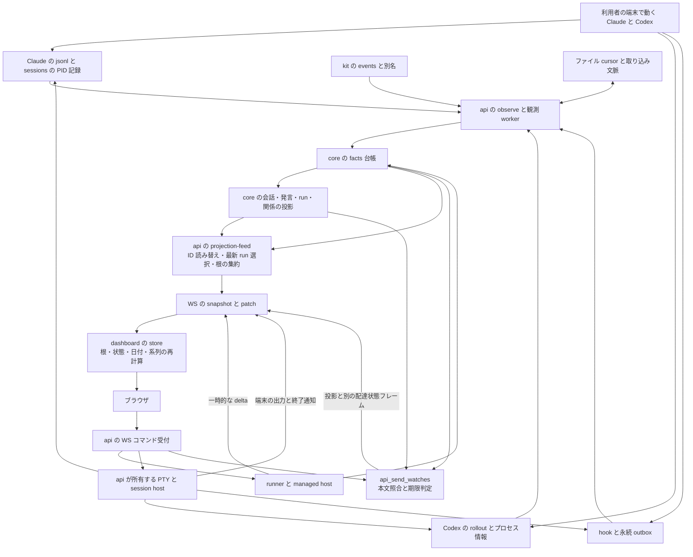

# agent-graph の構造に対する独立評価

## 最も重要な結論

- 最大の問題は、欠けることのある過去の通知を、現在状態の確かな根拠として無期限に扱うことである。
- 会話と実行の同一性を取り込み時の情報で決めるため、後着の情報を加えても誤った分割が残る。
- ブラウザからの操作は実行の所有者と配達確認の方式が分かれ、観測の失敗を操作の失敗として表示する。
- 台帳は監査と履歴には適しているが、外部世界の現在状態には期限付きの観測と継続的な照合が必要である。
- `identity-redesign.md` は必要な整理を含むが、この三つの前提を直す設計には届いていない。

## 評価の範囲と根拠の強さ

調査日は 2026-10-15 である。
コードの基準は `d749a823b48e1cfa3135c883287a5e07feea589d` である。
以下の `file:line` はこの作業ツリーの位置を示す。
時刻は比較のため UTC に統一する。

設計の正本として `docs/agents/architecture-v2.md` を読んだ。
取り込み、台帳、投影、配信、画面、端末、runner、関連試験を追った。
先にコードと本番データから問題を抽出した。
その後で `docs/agents/identity-redesign.md` と比較した。
別の AI が作成中の障害一覧や根因分析は評価の根拠にしていない。

本番 DB は `sqlite3 -readonly` と `DatabaseSync` の `readOnly: true` で開いた。
本番 DB に対して service の初期化や rebuild は実行していない。
Claude と Codex の実記録は読み取りだけを行った。
この文書以外のファイルは変更していない。

初回の集計時刻は `2026-10-15T05:40:42Z` だった。
その時点で facts は 307,171 件だった。
内訳の主なものは transcript-claude が 196,450 件、rollout-codex が 85,529 件、hook が 8,513 件、kit が 2,821 件だった。
これは履歴件数であり、現在の利用率や障害率ではない。
別の読み取り時点の conversations では observed が 3,170 件、managed が 5 件だった。
本番で外部観測が重要な経路になっていることは確認できる。

DB は稼働中なので、すべての集計が同じスナップショットではない。
個別の照合は短い読み取りトランザクションで行った。
facts の実例は seq と native ID で特定する。
可変表の状態は調査時点の値である。
利用者の発言本文や実行したコマンド本文は転載しない。

根拠を次の三つに分ける。

| 区分 | 意味 |
| --- | --- |
| 本番実例 E | 本番の台帳、可変表、実記録で確認した事実 |
| 再現 P | 読み取ったデータか最小入力を、既存の純粋関数にメモリ上で渡した結果 |
| 予測 F | コード上の条件から導いた未確認の障害 |

利用者が挙げた過去の障害を、すべて同じ原因で説明できたとは主張しない。
特に「会話に最新が出ない」と「同じ根が二行になる」の個々の発生時点は再現していない。
現在の画面を操作して過去の表示を再確認することも行っていない。

## 現在のデータの流れ



取り込みの主要な境界は `packages/api/src/service/index.ts:410` と `packages/api/src/service/index.ts:480` にある。
履歴を先に読み、outbox やプロセスの照合を後から処理する経路がある。
Claude の run の割り当ては、その時点で見えている hook と自前の run に依存する。
該当箇所は `packages/api/src/observe/claude/context.ts:114` である。

facts は入力された解釈を保存する。
外部ファイルの完全な複製ではない。
同じ source と source_event_id の異なる内容は競合になる。
該当箇所は `packages/core/src/ledger/ledger.ts:152` である。

core の投影をそのまま表示する構造でもない。
API は最新 run を選び直して roots を作る。
画面はさらに根の状態と日付と名前を計算し直す。
配達状態は facts と投影から独立した可変表に保存される。

設計書は API の再起動で実行を止めない境界を置いている。
根拠は `docs/agents/architecture-v2.md:200` である。
実装には API 自身が CLI の PTY を起動する第二の実行経路がある。
根拠は `packages/api/src/terminal/hosts.ts:234` である。
ここは図の見た目以上に大きな責務の分岐である。

## 本番で確認した実例

### E1 29 時間以上前の開始証拠で子を running に保つ

対象は Claude の子 `agent-a46a60f85e3267c52` である。
親は `fea1ff97-d236-4423-988d-f0090de135ec` である。

| seq | 種類 | 内容 |
| --- | --- | --- |
| 298565 | relation.created | 親から子への delegated が confirmed |
| 298566 | conversation.created | 子の会話を subagent として登録 |
| 298573 | run.created | 世代 `1791936609463` を unknown で作成 |
| 298574 | run.state_changed | `2026-10-14T00:10:09.463Z` の turn_started で running |

調査時の runs は running だった。
last_evidence_ts は開始時刻のままだった。
初回集計時点で証拠は約 29.5 時間前だった。
この run の facts を純粋な `projectRuns` に渡しても running になった。

実記録は次の場所にある。

`~/.claude/projects/-Users-r-00-project-agent-graph/fea1ff97-d236-4423-988d-f0090de135ec/subagents/agent-a46a60f85e3267c52.jsonl:271`

最終行は `2026-10-14T00:18:12.045Z` の Bash の tool_use だった。
stop_reason は null だった。
この記録だけでは子の現在の生死を断定できない。
確認できた欠陥は、現在の生死を確認できないのに running を保つことである。
子は生存照合から明示的に除外されている。
根拠は `packages/api/src/observe/session-query.ts:28` と `packages/api/src/observe/session-query.ts:69` である。

### E2 届いた二件を未着として保存する

対象の会話は `1c0d055c-8912-452b-b273-47e9874df7e8` である。
二件とも `!` で始まる端末コマンドだった。

| watch ID | sent_ts | baseline_seq | 記録された message の seq | failed_ts |
| --- | --- | --- | --- | --- |
| `896eb201-37af-453c-ab95-05c0ed07ed4d` | 2026-10-14T09:08:58.299Z | 301134 | 301136 | 2026-10-14T09:09:58.785Z |
| `8dceda21-b727-4ec8-bcbf-70017d8f5738` | 2026-10-14T09:09:13.099Z | 301144 | 301145 | 2026-10-14T09:10:13.310Z |

調査時の api_send_watches は二件とも failed だった。
message_id は二件とも null だった。
一件目の実記録は次の場所にある。

`~/.claude/projects/-Users-r-00-project-agent-graph/1c0d055c-8912-452b-b273-47e9874df7e8.jsonl:137`

二件目は同じファイルの 145 行目にある。
実記録の message ID は順に `88548f43-087b-4425-9cd0-61bbb2b6bc54` と `10c7f624-96c0-465f-81ea-ede483e86e7a` である。
実記録の本文は `<bash-input>` で囲まれている。
送信本文の先頭の `!` と記録側のタグを除くと、それぞれ一致した。
台帳への取り込みも未着判定より前に終わっていた。

現在の `normalizeSentBody` に両側を渡すと一致しなかった。
根拠は `packages/api/src/service/send-watch.ts:34` である。
照合は投影後の role=user の発言も要求する。
根拠は `packages/api/src/service/send-watch.ts:172` である。
この二件では Claude の入力記録に到達したことまで確認できる。
コマンドの実行成功まではこの証拠から判断しない。

### E3 同じ会話に別々の世代と終状態が残る

対象は `396247a1-5fc0-48e2-b984-2f4a8dac1f17` である。

| seq | 情報源 | 世代 | 内容 | observed_ts |
| --- | --- | --- | --- | --- |
| 301161 | transcript-claude | 1791968959857 | 自前の run を作成 | 2026-10-14T09:09:20.482Z |
| 301162 | transcript-claude | 1791968959857 | running | 2026-10-14T09:09:20.482Z |
| 301164 | hook | 1791968959355 | UserPromptSubmit で running | 2026-10-14T09:09:20.522Z |
| 301165 | hook | 1791968959355 | 遅れて到着した SessionStart | 2026-10-14T09:09:20.523Z |
| 301178 | transcript-claude | 1791968959857 | idle | 2026-10-14T09:09:27.331Z |
| 301179 | hook | 1791968959355 | SessionEnd で ended | 2026-10-14T09:09:27.964Z |
| 301180 | hook | 1791968959355 | 遅れて到着した Stop | 2026-10-14T09:09:27.966Z |

調査時の runs に二本が残っていた。
JSON 形式の会話 ID を持つ自前の run は idle だった。
`claude:<native ID>` 形式の hook の run は ended だった。
自前の世代の数値は hook より 502 大きい。
API は世代の数値が大きい方を最新として選ぶ。
根拠は `packages/api/src/service/projection-feed.ts:522` である。

会話 ID の表記を統一するだけでは、この二本は同じ実行に戻らない。
問題は情報源ごとの実行区間の割り当てにある。
後から source_ts 順に並べても、すでに別 subject へ割り当てた facts は別のままである。

### E4 圧縮要約の意味は後日の再解釈で修正されている

message ID は `8f97c4a9-1cd5-4caf-947f-e9cf39e6ebcb` である。
seq 251644 は role=user の message.created だった。
元の payload に transcript_flags はなかった。
seq 289242 は同じ message に対する message.corrected だった。
後者には isCompactSummary と isVisibleInTranscriptOnly が入っている。
訂正の observed_ts は `2026-10-13T11:53:00.831Z` だった。

実記録には二つのフラグがある。
場所は次のとおりである。

`~/.claude/projects/-Users-r-00-project-obsidian/b50eb012-074b-4a2a-ae00-aabc9b94cc5a.jsonl:136`

現在の messages 投影では、この message は除外されていた。
これは現在も誤表示している例ではない。
修正には元の記録から意味を拾い直した訂正事実が必要だった。
古い facts の再生だけでは、捨てたフラグを復元できない。
訂正と除外の実装は `packages/api/src/observe/claude/index.ts:147` と `packages/core/src/ledger/projections/messages.ts:25` にある。

### E5 競合を記録して旧い内容を保持する

seq 301024 は observation.unsupported である。
対象は `354000b1-4a87-45e8-baa7-6c1fa209d741.jsonl` である。
理由は `Conflicting history; existing facts retained` である。
count は 5 である。
記録時刻は `2026-10-14T04:57:03.942Z` である。

競合を無言で上書きしない点はよい。
一方で、古い内容を保持して cursor を進めることは、正しい内容への復旧とは違う。
根拠は `packages/api/src/service/index.ts:333` と `packages/api/test/observation-recovery.test.ts:53` である。
この五件が利用者の「最新が出ない」という個別の申告に対応するかは未確認である。

### E6 Codex には不在照合が実際に働いている

seq 259872 は rollout-codex の run.state_changed である。
対象は `01a12a12-39e2-7e10-a459-95926539bae6` の世代 1 である。
last_evidence.kind は process_absent である。
`2026-10-11T08:29:57.121Z` に confirmed の idle になっている。

実記録は次の場所にある。

`~/.codex/sessions/2026/10/11/rollout-2026-10-11T17-26-39-01a12a12-39e2-7e10-a459-95926539bae6.jsonl:43`

最終行の時刻は `2026-10-11T08:27:21.582Z` だった。
生存照合が全くないという評価は誤りである。
問題は、開いている rollout ファイルが見つからないことを、会話の idle として確定する点にある。
根拠は `packages/api/src/observe/codex/sessions.ts:44` と `packages/api/src/observe/codex/sessions.ts:119` である。

## 六つの問いへの回答

### 1. 状態は何で決まり、通知が落ちると何が起こるか

| 状態に使う情報 | 実装 | 欠落や曖昧さの扱い |
| --- | --- | --- |
| Claude の user、tool_result、assistant の行 | `packages/core/src/ledger/turns.ts:53` | 行の形から turn を解釈する。stop_reason がなくても text があれば idle とする分岐がある |
| Codex の task_started、task_complete、turn_aborted | `packages/core/src/ledger/turns.ts:98` | 完了の通知が来なければ前の状態が残る |
| UserPromptSubmit と Stop | `packages/core/src/ledger/turns.ts:132` | running と idle を切り替える |
| hook と transcript の優先 | `packages/core/src/ledger/projections/runs.ts:106` | hook が running の間は transcript の turn_completed を無視する |
| 終了の証拠 | `packages/core/src/ledger/projections/runs.ts:23` | host_exit や世代が一致する SessionEnd を要求する |
| 時間の経過 | `packages/core/src/ledger/projections/runs.ts:65` | 現在時刻を入力に持たない。新しい事実がなければ状態は変わらない |
| 未着 | `packages/api/src/service/send-watch.ts:168` | 本文が一致しなければ期限後に failed とする |
| 子の完了表示 | `packages/dashboard/app/src/lib/roots.ts:249` | Claude の子の idle を画面で ended に変える |

再現 P1 では hook の開始と transcript の完了だけを `projectRuns` に渡した。
Stop がないと running のままだった。
Stop を加えると idle になった。
同じ turn の完了証拠があっても、優先する情報源の欠落を補完できない。
E1 はこの問題よりさらに単純である。
子を対象にした生存照合も証拠の期限もない。

Claude の transcript は同じ状態が続く行から新しい状態事実を作らない。
根拠は `packages/api/src/observe/claude/context.ts:134` である。
last_evidence_ts をそのまま heartbeat とみなす修正も正しくない。
活動の継続と状態の遷移を別々に観測する必要がある。

現在の state には、プロセスの生死、turn の進行、入力待ち、依頼の完了が混在している。
idle は「依頼が成功した」を意味しない。
それを子の Done に読み替えると、情報量の少ない証拠から強い結論を作る。
E6 の process_absent もプロセス、会話、turn の境界をまたいでいる。

E2 の failed は「到着していない」とは限らない。
正確な意味は「この照合器が期限内に一致する記録を発見できなかった」である。
この意味の違いは文言の微調整では解消しない。
利用者は未着を見て再送するため、状態の誤判定が次の操作を変えてしまう。

### 2. 会話、根、run の同一性は何で決まるか

一次の識別材料は少なくとも六系統ある。
これは独立した六票ではない。
同じ実行を異なる時点と形式で見ている情報源である。

| 情報源 | 識別に使うもの | 食い違いが生じる場所 |
| --- | --- | --- |
| Claude transcript | ファイル名、ディレクトリ、native session、continued-in、時刻 | 子の row.sessionId は親を指すため、ファイル側の ID を採る。hook がなければ時刻から run を作る |
| Codex rollout | session_meta、ファイル名、行 ID、offset、archive | Claude と異なる世代の定義を持つ |
| hook | session_id、環境の run_id、保存した generation | transcript と異なる会話 ID 形式を使う。後着の開始通知がある |
| kit | session 名、node、attempt、native ID、親の別名 | provider がない native ID や名前の一致を手掛かりにする |
| runner と host | 管理する conversation、run、turn、resume | 管理外の同じ会話との結合が必要になる |
| 端末と OS | terminalId、PID、resumeId、PID に対応する session | 起動時の端末 ID と後から分かる会話 ID が別である |

関連箇所は `packages/api/src/observe/claude/index.ts:124`、`packages/api/src/observe/codex/index.ts:164`、`packages/api/src/hook/index.ts:40`、`packages/api/src/observe/kit/index.ts:79`、`packages/api/src/observe/kit/delegations.ts:166`、`packages/api/src/terminal/hosts.ts:161` である。
legacy の移行データと ui の訂正もこれらに重なる。

core の native ID 形式は provider と native ID の JSON 配列である。
根拠は `packages/core/src/ledger/projections/relations.ts:15` である。
しかし run の subject は完全にはこの形に統一されていない。
API と画面には別々の読み替えが残る。
E3 は表記の差と世代の差が同時にある実例である。

根は独立した永続 ID を持つ実体ではない。
現在見えている会話と関係から作る集合である。
さらに同じ project と kit_name だけでも会話を結ぶ。
根拠は `packages/core/src/ledger/projections/roots.ts:59` である。
kit 名がある project では、名前のない根を除外する。
根拠は同ファイルの 79 行目である。
推定の delegated も子として根の除外に影響する。
根拠は同ファイルの 47 行目と 84 行目である。
表示名や推定関係が単なる説明を越えて、一覧の存在を決めている。

再現 P2 では、子だけが見えている系列に、後から古い親と confirmed の継続関係を加えた。
根の ID は子から親へ変わった。
根拠は同ファイルの 89 行目と 106 行目である。
時刻で選ぶ代表要素は、後着データに対する不変 ID ではない。

再現 P3 では、本番の同名系列から関係を除いて `projectRoots` に渡した。
それでも同じ名前の会話は一つにまとまった。
本番の `agent-graph-027` には confirmed の継続関係も存在する。
本番のその結合が誤りだったという証明には使わない。
この再現が示すのは、関係がなくても名前で同一性を決める規則そのものである。

### 3. 同じ値を複数の場所で計算しているか

計算している。
API が core の関数を呼ぶこと自体は問題ではない。
入力の選び方と、その後の再解釈が別々の規則になっていることが問題である。

| 値 | core | api | dashboard |
| --- | --- | --- | --- |
| 根の状態と操作先 | `projections/roots.ts:101` で状態と時刻から選択 | `service/projection-feed.ts:522` で数値世代から最新 run を選ぶ | `lib/roots.ts:118` で状態を上書きする。`lib/roots.ts:160` に操作先の補完規則がある |
| 最終活動時刻 | `projections/roots.ts:104` で系列と子孫を集約 | `service/projection-feed.ts:528` で発言と run の時刻を合成 | `lib/roots.ts:120` で発言時刻を使って上書きする |
| 会話と run の ID | `projections/relations.ts:15` と `projections/runs.ts:118` | `service/screen-identities.ts:5` と `service/projection-feed.ts:185` | `lib/identities.ts:5` |
| 完了状態 | `projections/runs.ts:145` で終了証拠を検査 | `observe/claude/sessions.ts:55` で不在を idle にする | `lib/roots.ts:249` で子の idle を ended にする |

表の core のパスは `packages/core/src/ledger/` からの相対位置である。
api のパスは `packages/api/src/` からの相対位置である。
dashboard のパスは `packages/dashboard/app/src/` からの相対位置である。

E3 の二本の run は、この複数段の「最新」の選び方へ流れ込む。
E1 の古い running は活動順位の入力になり続ける。
API の snapshot と画面の状態が一致しても、外部の現状と一致する保証はない。
部分取得した画面データから業務上の値を計算し直すため、読み込み範囲にも意味が依存する。

### 4. 台帳を正とする作りは適しているか

監査、会話履歴、操作の記録に台帳を使うことは妥当である。
追記の重複排除、訂正の履歴、再構築の仕組みは残す価値がある。
問題は、外部で動く実行の現在状態まで、同じ意味で台帳の正とすることである。

現在の構造は概ね次の二段階である。

```text
取り込み事実 = 解釈する関数の結果 × その時点で見えている文脈
現在状態     = 保存された事実の投影
```

投影の再生順が決定的でも、取り込み時の解釈が到着順に依存すれば結果は収束しない。
E3 では hook が見える前に別の run を作った。
再生しても同じ誤った分割を再現する。
E4 では必要なフラグを元の facts に残していなかった。
元ファイルを再読して訂正を追加するまで意味は戻らなかった。

外部世界への収束には、少なくとも次の条件が必要である。

1. 通知が失われても、現在の状態か終了の証拠を別の経路で取り直せる。
2. 証拠が取り直せないときは、既知の状態の有効期限が切れる。
3. 後から正しい識別情報が来たときは、過去の割り当てを訂正できる。
4. 観測失敗と外部対象の停止を区別できる。
5. 訂正を含めた同じ外部履歴が、取り込み順の違いで別の意味にならない。

現実装はこの条件を満たさない。
E1 は新しい通知が来なければ固定点のままである。
E5 は競合を保持して先へ進む。
E2 の配達状態はそもそも facts の rebuild の対象ではない。

設計書自身は、沈黙や切断から終了を断定しない原則を持っている。
根拠は `docs/agents/architecture-v2.md:476` と `docs/agents/architecture-v2.md:762` である。
台帳という技術選択だけを原因にする評価は粗すぎる。
過去の確かな事実と、現在も有効な知識を同じ state にしていることが原因である。

### 5. 自分で正しい状態に戻る仕組みはあるか

部分的にはある。
ただし、経路ごとの回復能力が揃っていない。

| 仕組み | 回復できること | 回復できないこと |
| --- | --- | --- |
| hook の永続 outbox と再送 | 生成済み hook の一時的な通信失敗 | hook が実行されなかった場合や、誤った世代への割り当て |
| ファイル cursor と再読 | 追記、inode 変更、切り詰めなど | 解釈から落とした情報の自動復元や、解決規則のない競合 |
| Claude の PID 照合 | 一部の observed の running を idle へ戻す | subagent、PID 再利用、観測器自体の失敗 |
| Codex の ps と lsof | rollout を開くプロセスの不在を検出 | 未検出が停止を意味する保証 |
| runner の復旧 | managed 実行の unknown 化、承認の期限処理、resume | API が持つ PTY の永続的な引き継ぎ |
| projection の rebuild と WS の resync | 同じ事実から投影や受信状態を修復 | 欠けた終了通知、失った識別情報、未保存の配達確認 |
| failed の配達確認を再照合 | 後から来た一致する発言で closed に直す | 本文が一致しない到達、監視保存前の停止、保持期限後の照合 |

根拠は `packages/adapters/src/hook-v2/index.ts:90`、`packages/api/src/observe/files.ts:32`、`packages/runner/src/recovery.ts:43`、`packages/api/src/service/projection-feed.ts:504`、`packages/api/src/service/send-watch.ts:187` である。

Claude の sessions に壊れた JSON が一つあると、その周期は照合全体を打ち切る。
根拠は `packages/api/src/observe/claude/sessions.ts:17` である。
Codex のプロセス取得失敗も新しい状態事実を作らずに戻る。
根拠は `packages/api/src/observe/codex/sessions.ts:99` である。
不完全な走査から不在を断定しない点は正しい。
しかし観測失敗で既存状態の鮮度が下がる表現はない。
前の running はそのまま残る。

E6 は照合が実装され、実際に動いている証拠である。
E1 はその対象範囲の穴である。
対象外を unknown に落とす期限もなければ、穴は永久に残る。

API が持つ PTY はさらに別の問題を持つ。
PTY の終了通知は listener に送るが、この箇所では台帳に host_exit を残さない。
根拠は `packages/api/src/terminal/hosts.ts:292` である。
API の close は所有する PTY を kill する。
根拠は同ファイルの 354 行目である。
観測 worker の致命的失敗も API の終了処理へ進む。
根拠は `packages/api/src/cli.ts:116` と `packages/api/src/ws/index.ts:318` である。
観測対象を復旧するはずのサービスが、観測の故障に巻き込んで対象を止め得る。

### 6. 試験は実際の壊れ方を捕まえる形か

全く試験されていない製品ではない。
重複、再構築、遅延、配達期限、DB の競合、ブラウザ操作の試験がある。
最近の具体的な症状を対象にした試験もある。
ただし、正しいとする状態の定義そのものが不十分である。

| 試験 | 評価 |
| --- | --- |
| `packages/api/test/observe/claude-sessions.test.ts:43` | 不在の子が running のまま残ることを期待値にしている。E1 の穴を失敗として扱わない |
| `packages/api/test/observe/claude-sessions.test.ts:83` | 壊れた JSON で何も追記しないことを検証する。観測失敗後の鮮度低下までは要求しない |
| `packages/core/test/ledger/roots.test.ts:30` | kit の project で無名の根を除外する規則を固定する |
| `packages/core/test/ledger/roots.test.ts:78` | fork 関係がなくても同じ名前で結ぶ規則を固定する |
| `packages/api/test/observation-recovery.test.ts:53` | 競合時に旧い内容を保持して cursor を進めることを期待する |
| `packages/api/test/send-watch.test.ts:215` | failed 後の遅延到着を closed に戻す試験がある |
| `packages/api/test/send-watch.test.ts:290` | 同文の二回送信も試験する。本文照合の曖昧さを全く考慮していないわけではない |
| `scripts/e2e-ui.mjs:91` | rebuild 前後の一致を確認する。一致した内容が外部世界で正しいかは別である |
| `scripts/e2e/journeys.mjs:307` | fork 後に根が一行であることをブラウザまで確認する |
| `scripts/e2e/journeys.mjs:329` | `!` が届いた場合と失われた場合を分ける。E2 を検出し得る具体的な試験である |

ブラウザ試験は fake CLI の actorState も参照している。
台帳だけを正解にしていない点はよい。
根拠は `scripts/e2e/journeys.mjs:148` である。
一方で同じ箇所は Idle と Done のどちらも受け入れる。
turn の停止と依頼の成功の区別を保証する試験にはなっていない。

fixture の通常応答は end_turn か task_complete を生成する。
fork は親の continued-in を書いてから子を作る。
根拠は `scripts/e2e/fixtures.mjs:66` と `scripts/e2e/fixtures.mjs:93` である。
これだけでは、終端欠落や親の後着が通常の入力であることを検証できない。
確認した受け入れ経路には、欠落通知からの復旧期限を一貫して要求する契約が見当たらない。
リポジトリの全試験にその種のケースが一件もないと断定するものではない。

今回実行した試験は次の二ファイルである。

```sh
node --test --test-reporter=dot packages/core/test/ledger/roots.test.ts packages/core/test/ledger/turns.test.ts
```

22 件が成功した。
この成功は現在の根の結合規則も受け入れている。
関連試験が通ることと、製品の意味が正しいことは別である。
全体試験、実 CLI の有料 E2E、ブラウザ E2E は今回は実行していない。
`9-bang` の成否も今回は測定していない。

## 根本の問題を重い順に並べる

### 1. 外部世界について分かっている範囲をモデルにしていない

過去の開始を知っていることと、今も動いていることを同じ running にしている。
履歴に一致を見つけられないことと、届いていないことを同じ failed にしている。
観測の完全性、証拠の期限、観測器の健康状態が判定の必須入力ではない。
E1 と E2 が、この前提の誤りを別の機能で示している。

Stop の扱いを一つ増やしても、次の欠落点で同じ問題が起きる。
必要なのは現在状態について何を保証できるかの契約である。
設計書が observed を補助経路と位置付けるだけでは、外部観測が中心の本番用途を満たせない。

### 2. 操作の所有者と、操作を確定する証拠が統一されていない

managed の runner と API の PTY が並立している。
後者は API の寿命に結び付いている。
後者の入力は、貼り付けと Enter の後で履歴を探して確認する。
根拠は `packages/api/src/terminal/hosts.ts:89` である。

session コマンドの重複抑止は WS サーバーのメモリ上にも存在する。
根拠は `packages/api/src/ws/index.ts:224` である。
ブラウザは再接続時に pending のコマンドを同じ cmd_id で再送する。
根拠は `packages/dashboard/app/src/lib/client.ts:55` である。
メモリ上の抑止だけでは、再起動をまたぐ副作用の一回性を保証しない。

SendWatch は貼り付け後に別表へ記録する。
保存の再試行に失敗するとメモリ上の queue に残す。
根拠は `packages/api/src/service/send-watch.ts:82` である。
副作用と記録の間に停止の穴がある。
E2 はこの構造のうち、確認方式がすでに誤判定している証拠である。
同じ DB に表があっても、同じ操作契約にはなっていない。

### 3. 同一性を確定する時点が早すぎる

情報が部分的な取り込み時点で、run への所属を不可逆に近い形で決めている。
同一性の未解決と、独立した新しい実行を区別する規則が弱い。
E3 では後着の hook より大きい自前世代が最新として残る。
名前で結ぶ根の規則は、欠けた関係を表示上の都合で補っている。

同一性は記録を追加する処理の付随機能ではない。
訂正可能な対応表と、どの証拠で結んだかの履歴を持つ独立した責務にする必要がある。
世代の大小だけで情報源を横断した新旧を決める前提も捨てる必要がある。

### 4. 保存された解釈を、保存された観測と同一視している

facts にはすでに provider 固有の解釈が入っている。
解釈規則が間違うと、その誤りを忠実に rebuild する。
E4 は原記録の再読で直せた例である。
E5 は競合を検出しても解決はしていない例である。

追記専用は監査を守る性質である。
その性質だけでは、誤った意味や所属の訂正手順は得られない。
解釈の版を上げるたびに過去の状態事実を足す方式には、移行途中の可視性まで設計する必要がある。
根拠は `packages/core/src/ledger/projections/runs.ts:79` である。

### 5. 製品の意味を決める処理が複数の層に散っている

状態、最新、名前、所属、時刻、完了の定義を core、API、画面がそれぞれ補う。
一つの表示を直しても、他の表示や送信先の判断に同じ修正が届くとは限らない。
E1 と E3 の入力は、そのまま複数の判定経路へ流れる。

これは単なる関数の重複ではない。
同じ意味に対して複数の決定者がいる問題である。
試験も各層の現在の期待値を固定しやすくなる。

## 作り直す場合の前提

### 台帳と現在状態を別の責務にする

推奨するのは、履歴の台帳と現在状態の照合器を併用する構造である。
台帳を全面的に捨てる必要はない。
現在状態を過去の通知の最終値だけで決める方式は変える必要がある。

| 責務 | 保存するもの | 正とする範囲 |
| --- | --- | --- |
| 操作の記録 | cmd_id、明示的な対象、受付、送達証拠、結果 | この製品が受け付けた操作 |
| 観測の記録 | source、native ID、記録位置、元の分類情報、解釈版、走査結果 | その時点で何を観測したか |
| 同一性の台帳 | 安定 ID、別名対応、run の対応、関係の証拠、訂正 | どの実体にどの記録を所属させるか |
| 現在状態の snapshot | 値、根拠、有効期限、観測範囲、競合、最終確認時刻 | 指定した時刻で何を確かと言えるか |
| 表示用の投影 | 履歴、検索、木、一覧の値と版 | 同じ snapshot に対する表示契約 |

一つの DB で実装してもよい。
責務を分けるために新しいサービス群を増やす必要はない。
観測の元情報は必要な分類情報と安全な参照を中心に残す。
機密本文を無制限に二重保存する案ではない。

すべてをイベントで表現する方式も可能である。
その場合も、走査の成否、有効期限の失効、同一性の訂正をイベントとして追加する必要がある。
結局、外部との照合と時間の経過をモデルに取り込むことになる。
「イベント方式か snapshot 方式か」よりも、この契約を先に決めるべきである。

### 状態を少なくとも五つに分ける

| 軸 | 区別する内容 |
| --- | --- |
| 実行の生存 | 生存確認済み、終了確認済み、未確認 |
| turn の進行 | 実行中、承認待ち、入力待ち、応答完了、不明 |
| 依頼の結果 | 未完了、成功、失敗、中断、結果不明 |
| 入力の配達 | 受付済み、送出済み、受信確認済み、拒否、確認不能 |
| 観測の健康状態 | 正常、遅延、失敗、対象外 |

UI の Done は依頼の結果にだけ結び付ける。
過去の running の証拠が古くなれば現在の生存は未確認になる。
期限切れから成功や終了を作らない。
無出力の長時間処理もあるため、無出力だけで停止とは判断しない。
既定の期限は情報源ごとの観測能力と利用者への約束から決める。
この評価では根拠のない秒数を新仕様にしない。

継続した活動の証拠は状態遷移と別に更新する。
managed の host はプロセス識別と heartbeat を持つ。
observed の会話はファイル追記、完全な走査、利用可能な親子の完了情報を照合する。
子を照合できないときは、対象外であることと最後の確認時刻を表示する。

不在を使えるのは、その対象範囲の走査が成功した場合だけにする。
PID には起動時刻などの再利用を区別する値を付ける。
PID の不在と会話の完了は別々に保存する。
走査の失敗では値を維持しても、その値が現在も有効だとは表示しない。

### すべてのブラウザ起動を同じ実行所有者へ集める

runner か同等の常駐ホストに PTY の所有権を移す。
API と観測器の再起動から実行を切り離す。
実行の終了は同じ所有者が台帳へ記録する。
API は接続と表示と操作要求の中継を担う。

副作用の前に cmd_id と対象を永続化する。
同じ cmd_id の結果は再起動後も引けるようにする。
CLI が対応する経路では、受信側の command ID や native message ID を送信要求へ結び付ける。
本文一致は補助的な到達候補に留める。

PTY への入力だけでは、受信側を含む完全な一回性を保証できない。
送出直後に停止した場合は、結果を確認不能として残す。
確認不能を未着と断定して自動再送しない。
`!` を照合対象から外すだけでは、普通の同文入力や遅延履歴の問題は残る。

### 同一性を後から訂正できる形にする

会話の識別には provider と native ID を使う。
複数ホストを扱う場合は native ID の一意性の範囲も明示する。
元の表記は別名として保存する。
run は実行の区間を表す安定した ID にする。
壁時計の数値を、異なる情報源を比較する通し番号として使わない。

hook が遅れて来たら、自前 run と同じ区間かを照合する。
同じ区間なら、所属の対応を訂正する。
別レコードを統合したことを、プロセスが終了したこととして記録しない。
判断できない場合は重複候補として残す。

根には安定した操作上の ID を与える。
関係の追加で代表の会話が変わっても、保存したリンクを失わないようにする。
統合や分離の履歴と旧 ID の解決先を持つ。
同じ名前だけでは結ばない。

continued、forked、delegated は異なる関係として維持する。
fork 後の複数の会話が同時に動くことを許す。
系列を必ず一本の順序へ潰さない。
送信先は根の表示順位から推測しない。
選択した会話と実行を明示し、実行時にその対象の版と有効性を確認する。

### 製品の意味を決める処理を一か所にする

根の名前、状態、時刻、件数は同じ版の snapshot から作る。
API はその値を渡す。
画面は配置と表示形式を担当する。
画面に取得済みの一部データから業務上の値を再推定させない。

投影 seq に加えて、観測の完了地点と健康状態を配信する。
台帳へ入った全件を処理済みでも、元ファイルの読み取りが止まっていることはある。
「最新」の表示には両方の到達を要求する。
配達状態にも同じ snapshot の版か独立した明示的な版を与える。

### 復旧を受け入れ条件にする

通常入力で期待値になるだけでは不十分である。
以下の条件を製品の受け入れにする。

| 障害注入 | 必要な結果 |
| --- | --- |
| Stop、SessionEnd、task_complete を個別に落とす | 別の証拠で収束するか、期限付きで不明になる |
| 子が tool_use を最後に消える | 無期限に作業中とは表示しない |
| transcript、hook、親子記録を異なる順で取り込む | 同じ外部実行の所属と安定 ID が最終的に一致する |
| 同文を別端末から入力する | 関係のない送信要求の受信確認にしない |
| Enter の直後、ack の前に API を再起動する | 実行を維持し、操作の結果を失わず、無条件には再送しない |
| PID が再利用される | 別のプロセスを元の生存証拠にしない |
| sessions の一件が壊れる | 観測の部分的な失敗を見せ、他の証拠の鮮度も正しく扱う |
| 規則の版を更新して過去を再解釈する | 移行途中に半分だけの新解釈を確定表示しない |
| 投影更新中に snapshot と本文を読む | 同じ版として返す値に矛盾がない |

検証の正解は fake host の実行記録や受信記録など、製品の投影とは別に持つ。
本番実例 E1 から E6 は機密を除いて固定した fixture にする価値がある。
正常な並びだけでなく、遅延、欠落、重複、走査失敗を組み合わせる。
再生の一致と外部世界への収束を別々に検証する。

## identity-redesign.md は根に届いているか

評価は「必要な一部だが、これを完成しても基本の信頼性は回復しない」である。

| 提案 | 評価 |
| --- | --- |
| ID 形式の統一、名前で結ばない、推定で統合しない | 妥当である。`docs/agents/identity-redesign.md:173` の原則は採用すべきである |
| core だけで根の値を決める | 妥当である。同文書の 175 行目と 282 行目は重複した決定者を減らす |
| 最も古い会話を根 ID とし、会話が増えても変わらないとする | 成り立たない。同文書の 202 行目は後着の古い親を考慮していない。再現 P2 が反例である |
| 分岐を連結成分にしながら「現在の会話」を一つ選ぶ | 同時に動く枝への送信先が曖昧である。同文書の 201 行目と 203 行目に明示的な操作対象の契約が必要である |
| hook が後着したらそれを最新世代にする | 方向はよい。だが E3 の数値比較をどう解消するかまで必要である。同文書の 225 行目の宣言だけでは過去の所属は戻らない |
| 状態に経過時間を使わず、projectRuns を変えない | E1 と再現 P1 が残る。同文書の 228 行目と 320 行目は現在状態の有効期限を扱わない |
| PID の不在を idle にする | 生存と turn の混同を保つ。同文書の 231 行目は観測の完全性も必要とする |
| 普通の発言は本文一致で配達確認する | 同文、遅延取り込み、外部端末からの入力を区別できない。同文書の 237 行目は配達の根本契約を変えない |
| `!` を照合から外す | E2 の狭い対処にはなる。同文書の 240 行目は到達証拠の相関 ID を作る提案ではない |
| API 再起動の時刻を利用者と調整する | 移行時の配慮としては妥当である。同文書の 292 行目は API が実行を止める構造自体を直さない |
| 自前 run を superseded_by_hook で閉じる | 同文書の 389 行目はレコードの置換と実行の終了を混ぜる。同一実行への対応訂正として表すべきである |

`series` を配列にするなら、表示順と実際の関係を区別する必要がある。
複数の live run のどれかを選ぶ規則だけでは、利用者の操作意図は分からない。
順序を整える設計と、操作先を決定する設計を分けるべきである。

文書は `scripts/e2e/run.mjs` がまだ存在しないとしている。
該当箇所は `docs/agents/identity-redesign.md:336` である。
調査した HEAD には同ファイルと `9-bang` の試験がある。
受け入れ条件は現在のコードと試験に照らして更新する必要がある。
この版のずれは、設計案の根本的な不足とは別の問題である。

## 同じ根から起こり得る未確認の障害

以下は発生確認済みの障害一覧ではない。
発火条件を固定して検証できる予測である。

| ID | 発火条件と予測 | 根拠 | 確認方法 |
| --- | --- | --- | --- |
| F1 | ブラウザの送信が失われ、同じ本文を同じ会話の別端末から入力する。無関係な入力で closed になる | `packages/api/src/service/send-watch.ts:172` は baseline 後の取り込みと本文一致を使う。受信側の cmd_id を要求しない | 一方の入力だけ落とし、別端末の同文を取り込む |
| F2 | 過去の同文が送信後に遅れて取り込まれる。新しい送信が届いたと誤認する | 同ファイルの 175 行目は source の発生順ではなく facts の seq を境界にする | 過去の記録の取り込みを止め、新規送信後に再開する |
| F3 | 照合期限後に利用者が再送し、最初の入力も遅れて処理される。依頼が二回実行される | 同ファイルの 221 行目と E2 が示す未着判定の意味 | 受信済み入力の履歴反映だけを期限より遅らせる |
| F4 | session.launch の副作用後に ack を失い、API が再起動する。再送された同じ cmd_id が別の起動を行い得る | `packages/api/src/ws/index.ts:224` のメモリ上の記録と `packages/dashboard/app/src/lib/client.ts:55` の再送 | 起動と ack の間で停止する。起動回数と cmd_id の対応を見る |
| F5 | 親が後着するか別の枝が活発になる。根の ID や自動選択先が変わる | `packages/core/src/ledger/projections/roots.ts:89` と同ファイルの 101 行目。再現 P2 | 子だけでリンクと操作先を保存し、親と別枝を追加する |
| F6 | Claude の sessions に壊れた一件が残る。無関係な会話も古い running を維持する | `packages/api/src/observe/claude/sessions.ts:17` の全体打ち切り | 一件を壊した状態で別会話を終了させ、観測状態を見る |
| F7 | PID が再利用される。過去のセッションを生存中と判断し続ける | `packages/api/src/observe/claude/sessions.ts:32` は PID の存在だけを確認する | 元の PID に別プロセスを対応させたプロセス照合 fixture を使う |
| F8 | 履歴が同じ inode とサイズのまま先頭 4096 byte より後で書き換わる。更新を読まない可能性がある | `packages/api/src/observe/files.ts:32` の cursor と先頭署名。追記形式への依存である | 条件を保った差し替えを行い、訂正の検出を確かめる |
| F9 | 新しい turn 解釈版の事実が一部だけ取り込まれる。未移行部分の旧版が投影から除外される | `packages/core/src/ledger/projections/runs.ts:79` は subject ごとの最大版で旧版を外す | 同じ subject の再読を途中で止め、移行前後と途中の状態を比較する |
| F10 | 投影更新が読取境界をまたぐ。patch の版と取得した行の版が混ざる可能性がある | `packages/api/src/service/projection-feed.ts:326` は変更一覧を読んで COMMIT した後に refreshProjection を行う | COMMIT 後と行読取の間で writer を進め、本文と一覧の版を照合する |
| F11 | 観測 worker が致命的な失敗を起こす。ブラウザから起こした端末まで終了する | `packages/api/src/cli.ts:116`、`packages/api/src/ws/index.ts:318`、`packages/api/src/terminal/hosts.ts:354` | 隔離環境で worker を失敗させ、PTY の生存を見る |

F8 は、記録の生成側が追記以外の更新を行う場合の予測である。
その形式変更が本番で起きたとは確認していない。
F10 はコード上の読み取り境界に基づく競合の仮説である。
実際に矛盾した patch を捕捉したわけではない。

## 変更に着手する順序

1. 状態と配達の用語を定義し、何を確定できないかを明示する。
2. E1、E2、E3 と通知欠落の再現を、外部の正解を持つ受け入れ試験にする。
3. API から実行所有権を切り離し、操作の記録を副作用の前へ移す。
4. 同一性の対応訂正と証拠の期限を備えた現在状態を、既存表示と並行して比較する。
5. 根の業務上の値を一か所へ集め、画面と API の再計算を除く。
6. コピーした本番データで移行と回復を検証してから切り替える。

並行比較は移行の検証期間に限る。
恒久的に新旧二つの状態判定を残す案ではない。
既存の台帳、秘匿処理、履歴検索、outbox、再生試験は活用できる。
全面的な書き換えを先に決めるより、間違った保証を取り除くことが先である。

## 読み取り専用での再確認

以下は本文を出さずに、主要な実例の所在を確認するコマンドである。
可変表の値や保持期限を過ぎた watch は、調査時と変わる場合がある。

```sh
sqlite3 -readonly "$HOME/.local/state/agent-graph/agent-graph.db" <<'SQL'
.headers on
.mode column
BEGIN;
SELECT seq, source, kind, subject, source_ts, observed_ts,
       json_extract(payload, '$.state') AS state,
       json_extract(payload, '$.generation') AS generation
FROM facts
WHERE seq IN (
  298565, 298566, 298573, 298574,
  301136, 301145,
  301161, 301162, 301164, 301165, 301178, 301179, 301180,
  251644, 289242, 301024, 259872
)
ORDER BY seq;

SELECT id, conversation_id, generation, state, last_evidence_ts
FROM runs
WHERE conversation_id IN (
  '["claude","agent-a46a60f85e3267c52"]',
  '["claude","396247a1-5fc0-48e2-b984-2f4a8dac1f17"]',
  'claude:396247a1-5fc0-48e2-b984-2f4a8dac1f17'
);

SELECT id, conversation_id, sent_ts, baseline_seq, state, message_id, failed_ts
FROM api_send_watches
WHERE id IN (
  '896eb201-37af-453c-ab95-05c0ed07ed4d',
  '8dceda21-b727-4ec8-bcbf-70017d8f5738'
);
COMMIT;
SQL
```
